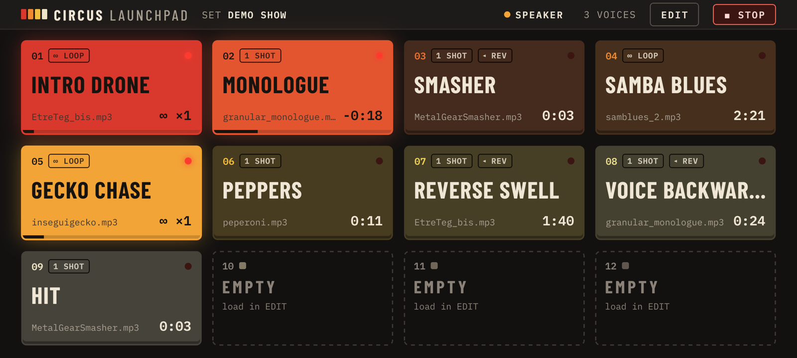
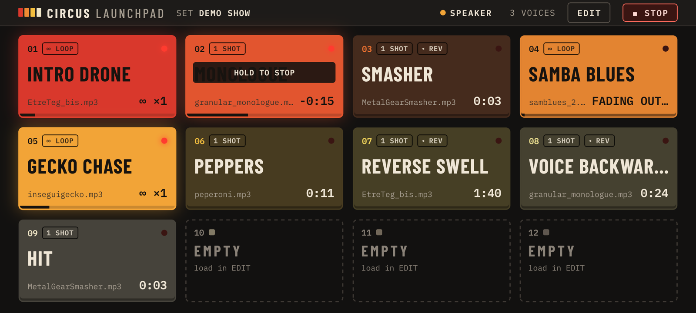
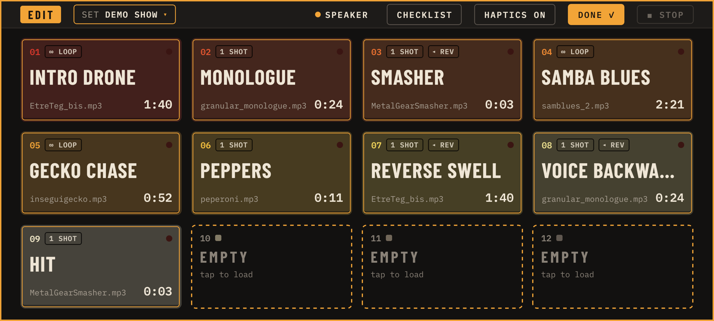
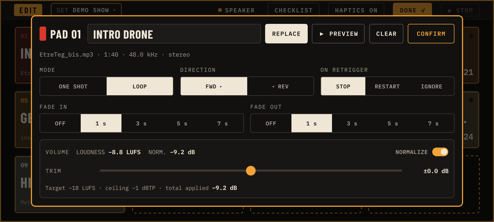
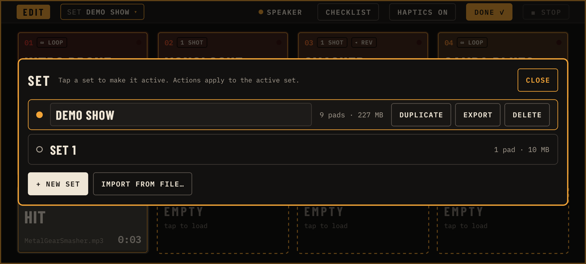
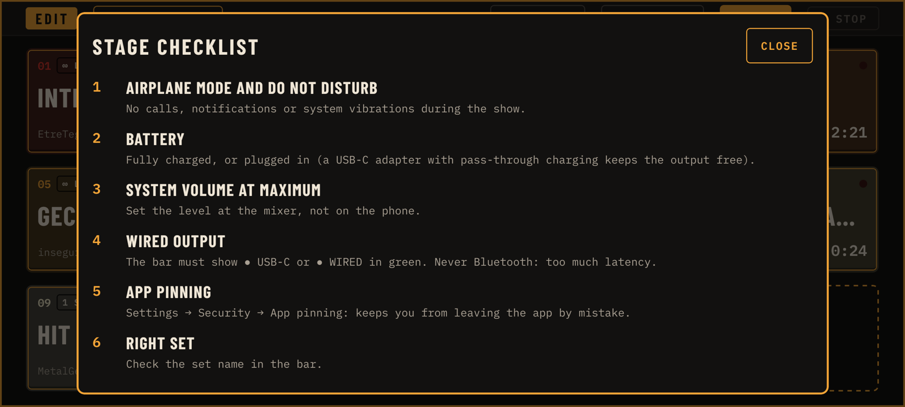

# Circus Launchpad

An open-source sample launcher for Android, built for playing live: for anyone who needs to fire sounds on cue, on
stage or anywhere else. It has 12 big pads, and each pad holds one audio file from the phone and starts the moment you
touch it. A pad can play as a one shot or as a seamless loop, forwards or in reverse. Loudness is matched
automatically, every pad has its own fades, and you can keep one set of pads per show and move sets between phones as
a single `.circus` file.



Full product spec, design decisions and development status (in Italian): [`docs/SPEC.md`](docs/SPEC.md).

## Install

You need Android 12 or newer. The app is not on the Play Store: it is installed from an APK.

1. On the phone, download the APK of the latest release:
   [**circus-launchpad-release.apk**](https://github.com/francescocretti/circus-launchpad/releases/latest/download/circus-launchpad-release.apk)
   (all versions are on the [Releases page](https://github.com/francescocretti/circus-launchpad/releases)).
2. Open it. Android asks you to **allow installs from this source** (the browser or Files): allow it.
3. **Play Protect** may warn that the app is unknown. Choose **Install anyway**. This happens because the app does
   not come from the Play Store.
4. Updates work the same way: download the APK of the new release and install it over the old one. Your sets and
   samples are kept.

## The two modes

The app has a single screen with two modes:

- **PLAY** is for the stage. Pads react the moment you touch them and nothing else on screen can get in the way.
- **EDIT** is for preparing a set: tap `EDIT` in the top bar. The grid gets an amber frame, and tapping a pad opens
  its settings instead of playing it. Tap `DONE ✓` (or the Android back button) to go back to PLAY.

## Playing



- **Touch a pad to start it.** Playback starts on touch, not on release. You can play several pads at once with
  several fingers.
- A playing pad lights up in its color, its LED turns on and a bar along the bottom shows the progress. One shots
  count down the time left (`-0:18`). Loops show how many times they have repeated (`∞ ×1`).
- **Touching a pad that is already playing** does what its *On retrigger* setting says:
  - `STOP` fades it out (the default for loops);
  - `RESTART` starts it again from the top when you lift your finger;
  - `IGNORE` does nothing and shows `HOLD TO STOP` (the default for one shots, so a second accidental tap can't cut
    a sample short).
- **Hold a playing pad for 0.7 s to stop it**, whatever its retrigger setting is. It stops with its own fade out.
- While a pad fades out, its LED blinks and the time is replaced by `FADING OUT…`. Touching it during the fade starts
  it again.
- **`■ STOP`** in the top bar stops everything quickly, ignoring the pads' fade outs. You have to hold it for 0.3 s,
  so a brush of the finger won't trigger it.
- The top bar also shows the set name, how many voices are playing and where the sound is going (see
  [Audio output](#audio-output)).
- Each touch on a loaded pad gives a short vibration. You can turn it off in EDIT with `HAPTICS ON/OFF`.

## Editing a pad



In EDIT, tap any pad to open its window. Every change is saved straight away. `CONFIRM` closes the window.



- **`LOAD` / `REPLACE`** picks an audio file from the phone: WAV, MP3, M4A, FLAC or OGG. The app keeps its own copy,
  so you can delete or move the original afterwards.
- **Label**: the big name on the pad, up to 16 characters. If you leave it empty, the pad shows the file name.
- **`▶ PREVIEW`** plays the pad from inside the window. **`CLEAR`** empties the pad (tap again on `SURE?` to
  confirm).
- **Mode**: `ONE SHOT` plays the file once; `LOOP` repeats it seamlessly until you stop it.
- **Direction**: `FWD ▸` or `◂ REV`. Reverse plays the whole file backwards, from the end to the start.
- **On retrigger**: what a touch does while the pad is playing (see [Playing](#playing)).
- **Fade in / Fade out**: `OFF`, 1, 3, 5 or 7 seconds. Fade out applies when you stop a pad by touching or holding
  it, not with `■ STOP`.
- **Volume**: each file is measured on load (loudness in LUFS, like broadcast meters) and brought to −18 LUFS, so all
  pads sound about equally loud. Gain is capped so that peaks never go over −1 dBTP: when that limits a loud-peaking
  file, the window says `peak-limited`. `TRIM` adds ±12 dB on top, and `NORMALIZE` turns the automatic part off.

Changes to volume apply immediately, even while the pad is playing. Mode, direction and fades apply from the next time
the pad starts.

The window warns you about files longer than 5 minutes and about sets that use more than 300 MB of memory: big sets
take longer to load when the app starts.

## Sets

A set is a full grid of 12 pads, for example one per show or one per song list. In EDIT, tap the set name in the top
bar (`SET … ▾`) to manage them.



- Tap a set to make it the active one. The buttons on the active set act on it: `DUPLICATE`, `EXPORT`, `DELETE`.
- Rename the active set by editing its name in place.
- `+ NEW SET` creates an empty set.
- **`EXPORT`** saves the set and all its samples into a single `.circus` file and opens the Android share sheet: send
  it to Drive, a chat or another phone.
- **`IMPORT FROM FILE…`** loads a `.circus` file as a new set. It never overwrites an existing set: if the name is
  already taken, the imported set is called `… (IMPORTED)`.

Samples shared by several pads or sets are stored only once.

## Audio output

The top bar always shows where the sound is going:

| Indicator | Meaning |
| --- | --- |
| `● USB-C` (green) | USB-C audio adapter or USB interface. |
| `● WIRED` (green) | Wired headphones or line out. |
| `● SPEAKER` (amber) | The phone's own speaker: fine for testing, not for the stage. |
| `● BLUETOOTH · HIGH LATENCY` (red) | Bluetooth adds too much delay to play in time. Don't use it live. |

When the output changes, for example when you plug in the cable, the indicator flashes `OUTPUT → …` for a few seconds.

## Stage checklist



You'll also find it in the app, in EDIT → `CHECKLIST`.

1. **Airplane mode and Do Not Disturb**: no calls, notifications or system vibrations during the show.
2. **Battery**: fully charged, or plugged in. A USB-C adapter with pass-through charging keeps the audio output free.
3. **System volume at maximum**: set the level at the mixer, not on the phone.
4. **Wired output**: the bar must show `● USB-C` or `● WIRED` in green. Never Bluetooth.
5. **App pinning** (Settings → Security → App pinning), so you can't leave the app by mistake.
6. **Right set**: check the set name in the bar.
7. **Test every pad** at soundcheck, once each, with the engineer at the mixer.

The screen stays on while the app is open.

## Development

React Native with Expo (development build, not Expo Go: the audio engine is native). Android only, API 31+, arm64.

```bash
npm install
npx expo run:android            # native development build
npm test                        # audio engine, gestures and .circus format tests
npm run typecheck && npm run lint
npm run apk                     # signed APK: android/app/build/outputs/apk/release/circus-launchpad-release.apk
```

Release signing reads `CIRCUS_KEYSTORE_FILE`, `CIRCUS_KEYSTORE_PASSWORD`, `CIRCUS_KEY_ALIAS` and
`CIRCUS_KEY_PASSWORD` from `~/.gradle/gradle.properties`. Without them, the APK is signed with the debug key.
